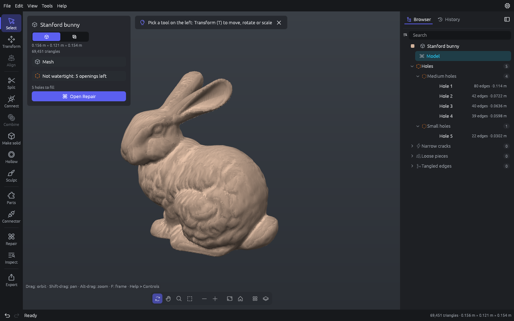
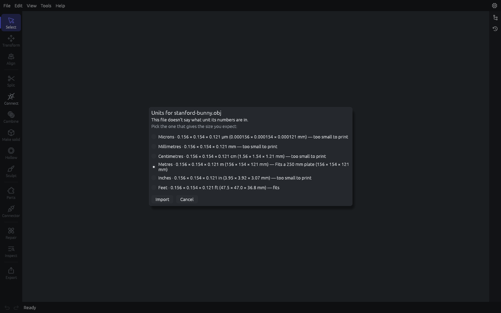
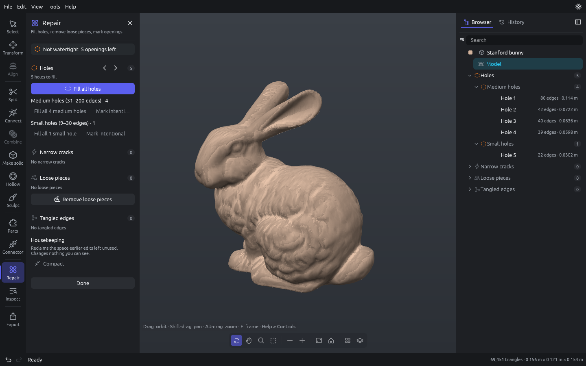
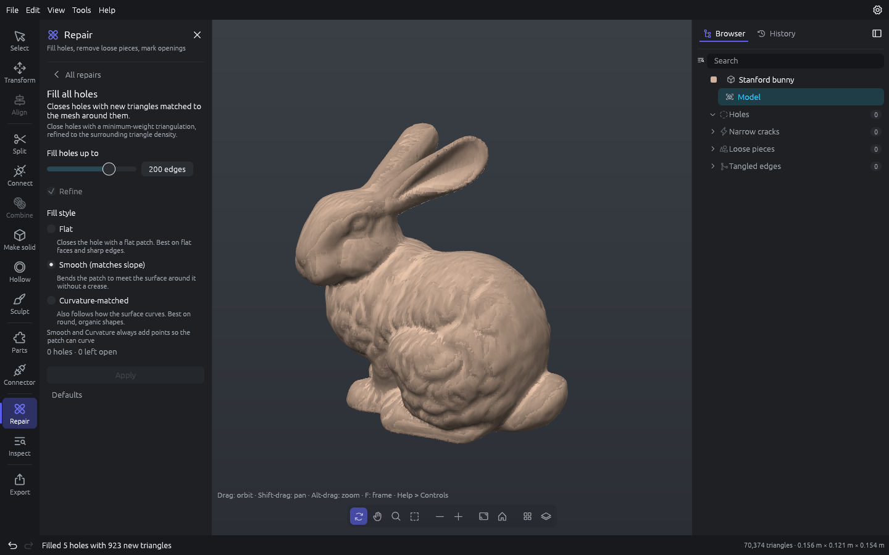
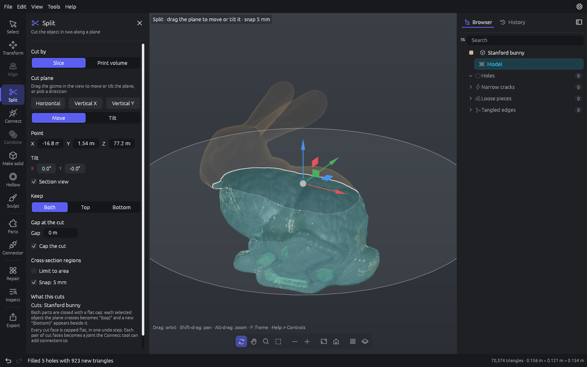
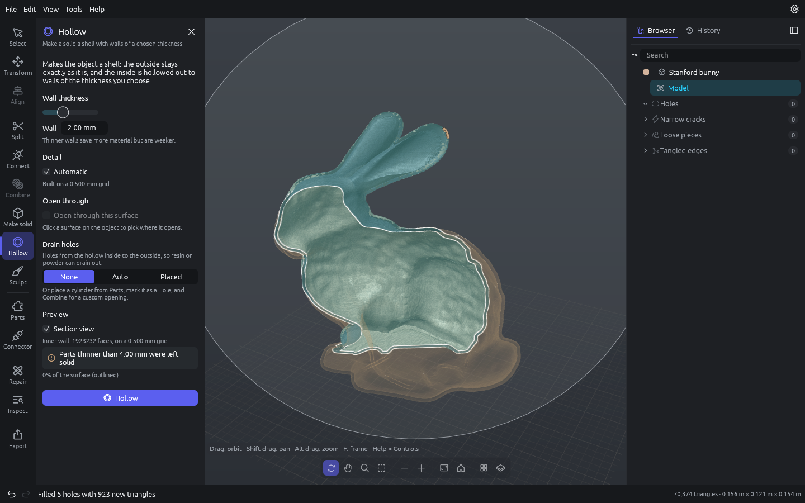
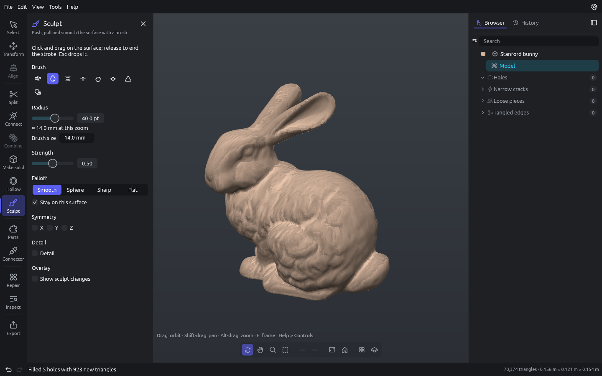
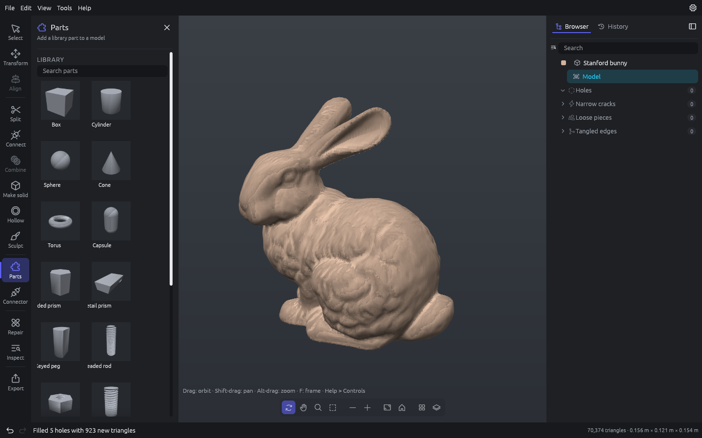
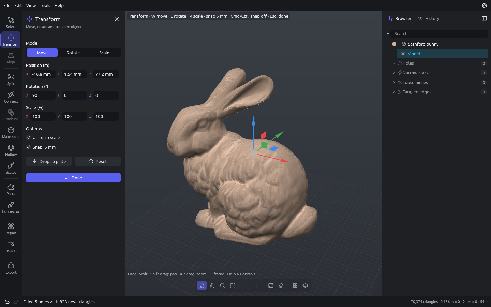
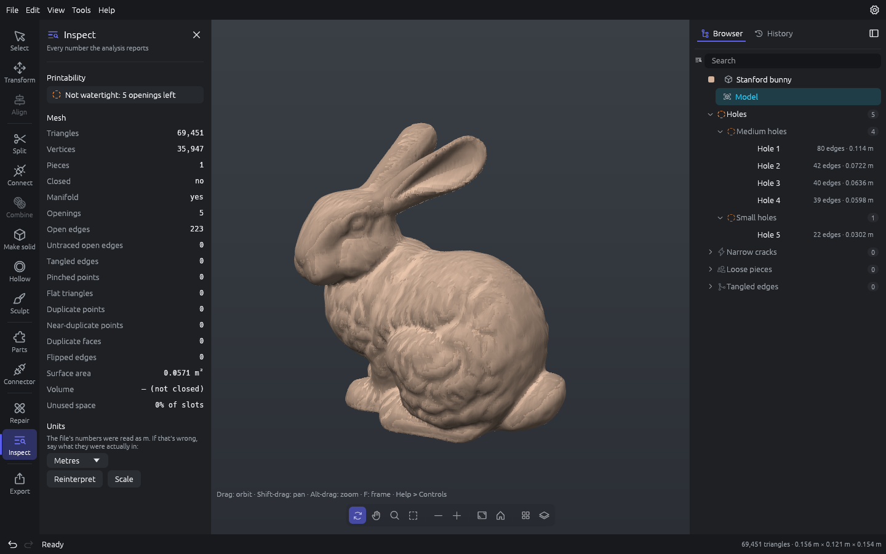

<p align="center">
  
</p>

<h1 align="center">MeshFixer</h1>

<p align="center">
  <b>Fix, cut, join and shape 3D models for printing: a modern take on the Meshmixer workflow.</b><br>
  Open source · Fast on huge scans · macOS, Windows and Linux
</p>

<p align="center">
  
</p>

MeshFixer is a desktop app for turning messy 3D files (scans, AI-generated models, broken STLs) into parts you can actually print. Open a model and MeshFixer tells you what's wrong with it in plain words. Then you can:
- repair it;
- cut it into pieces that fit your printer, with pegs or dovetails to line the pieces back up;
- hollow it, sculpt it, or combine it with other parts;
- export it.

It was inspired by Autodesk Meshmixer, which is no longer developed. It keeps Meshmixer's direct, hands-on style of working, and it's built to stay responsive on models of tens of millions of triangles.

## Contents

- [What it does](#what-it-does)
- [Install](#install)
- [Your first print-ready model](#your-first-print-ready-model)
- [Tour](#tour)
- [Units and sizes](#units-and-sizes)
- [Navigating the view](#navigating-the-view)
- [Command line](#command-line)
- [Known limitations](#known-limitations)
- [Building from source](#building-from-source)
- [Credits and licence](#credits-and-licence)

## What it does

| | |
|---|---|
| **Inspect** | Every problem a printer cares about, named and counted: holes, cracks, loose pieces, tangled edges, flipped edges, duplicate faces. |
| **Repair** | Fill holes, flat or matched to the surrounding curve. Remove loose pieces. Make solid rebuilds a model that overlaps itself into one clean solid. |
| **Split** | Cut along a plane (level, upright or tilted) or to fit your printer's build volume. Keep the top, the bottom or both. Caps close the cut, or leave it open for a vase. |
| **Connect** | Add pegs, dowels, dovetails, hinges, clasps and threads across a cut so the printed pieces line up and hold together. Each fit comes from your printer's tolerance and the fit you choose. |
| **Combine** | Join parts, or mark one as a **Hole** and cut it out of another, like in Tinkercad. |
| **Hollow** | Turn a solid into a shell with walls of a set thickness, to save resin and filament. Add drain holes, or open it through a face to make a vase. |
| **Sculpt** | Push, pull, smooth and inflate the surface with a brush. |
| **Parts** | A library of ready-made shapes and connectors to place on your model. |
| **Arrange** | Move, rotate, scale and align objects on the build plate, with snapping that adapts as you zoom. |

Every step can be undone. History shows each one in plain words, with its settings in your units.

## Install

Download the latest version from [**Releases**](https://github.com/thevgergroup/MeshFixer/releases/latest).

### macOS (Apple silicon)

1. Download `MeshFixer-<version>-macos.zip` and unzip it.
2. Move **MeshFixer.app** to Applications.
3. The app is signed but not notarized yet, so macOS will block it the first time. Open it once, then go to **System Settings › Privacy & Security** and click **Open Anyway**.

### Windows (64-bit)

1. Download `MeshFixer-<version>-windows-x64.zip`, right-click it and choose **Extract All**.
2. Open the extracted folder and run **MeshFixer.exe**.
3. The app isn't code-signed on Windows yet, so SmartScreen may warn you the first time. Click **More info**, then **Run anyway**.

Nothing is installed system-wide: to remove MeshFixer, delete the folder.

### Linux

There's no ready-made download yet. [Build from source](#building-from-source); it takes a few minutes.

## Your first print-ready model

1. **Open your model.** Use **File › Open**, or drop an `.stl`, `.obj` or `.3mf` file on the window.
2. **Check its size.** STL and OBJ files don't say what unit they were made in, so MeshFixer suggests the unit that fits your build plate. Here it picks metres for the Stanford bunny.

   

3. **Repair it.** The panel on the left tells you whether the model can be printed. Click **Open Repair**, then **Fill all holes**, then **Apply**.
4. **Cut it to fit, if you need to.** Choose **Split**, drag the plane, and then click **Cut**.
5. **Line the pieces up.** Choose **Connect** to add pegs or dowels across the cut.
6. **Export.** Choose **Export**, then **STL** or **3MF**. Sizes are always written in millimetres.

## Tour

### Repair



The Stanford bunny scan has five holes, including a large opening in its base. Repair groups problems by kind and size, so you can fix them all at once or one at a time. Holes you want to keep, such as a vase's opening, can be marked as intentional instead.



After **Fill all holes**, the bunny is watertight. The status bar reports how many triangles were added.

### Split



Drag the arrows to move the plane, or the rings to tilt it. While you drag, the cut face is shown live. You choose what to keep, whether the cut is capped, and whether to leave a gap between the pieces. Split works on huge models: a 30-million-triangle scan takes about 1.4 seconds.

### Hollow



Set the wall thickness. The section view shows the inner wall before you commit. Parts too thin to hollow are left solid, and MeshFixer tells you which ones. Add drain holes, or click a face to open the shell through it.

### Sculpt



The brush size is measured on screen, and the panel shows what that size is on the model at the current zoom, for example "≈ 14 mm at this zoom". The same brush works whether a model is 10 mm or 3 m across. **Stay on this surface** stops a stroke spilling onto the next part.

### Parts library



Place shapes and connectors on your model, then Combine them in as solids or holes. Parts keep their real size, whatever unit your model is in.

### Transform and Inspect



Move, rotate and scale objects with the gizmo or by typing values. **Drop to plate** sets the model on the bed. Snapping is on by default; hold **⌘/Ctrl** while dragging to turn it off.



**Inspect** lists every number the analysis finds. It also has the **Units** control: use it when a file was read in the wrong unit.

## Units and sizes

- **Typed units.** Every length field accepts units and simple arithmetic: `10 in`, `25.4mm`, `5 cm + 2 mm`, `1/8 in`. A plain number means the document's unit.
- **Import.** MeshFixer suggests the unit that makes the model fit your plate, and remembers your choice for each folder.
- **Fixing it later.** Use **Inspect › Units**:
  - **Reinterpret** keeps the numbers and changes the unit, for when the file was in inches, not millimetres.
  - **Scale** changes the model's real size.

  Both can be undone.
- **Export.** Always in millimetres, which is what slicers expect.

## Navigating the view

| Action | How |
|---|---|
| Orbit | Drag |
| Pan | Shift-drag |
| Zoom | Alt-drag, or scroll |
| Frame the selection | **F** |
| Reset the view | **Home**, or **⌘/Ctrl-0** |
| Transform | **T**, then **W** to move, **E** to rotate, **R** to scale |
| Snap off while dragging | Hold **⌘/Ctrl** |
| Cancel a drag, or close a tool | **Esc** |
| Delete the selected part | **Backspace** |
| Undo / redo | **⌘/Ctrl-Z** / **⌘/Ctrl-Shift-Z** |

## Command line

Every operation in the app is also available as a `meshfixer` command, for scripting and batch work. It comes with the app:
- **macOS:** `MeshFixer.app/Contents/Resources/bin/meshfixer`.
- **Windows:** `cli\meshfixer.exe`, in the extracted folder.

```bash
meshfixer inspect scan.stl                                  # what's wrong with it
meshfixer fill-holes scan.stl --output fixed.stl            # repair
meshfixer split-plane fixed.stl --keep both --output cut.3mf  # cut in two
meshfixer --help                                            # every command
```

Each command records what it did. `meshfixer replay` re-runs a saved session exactly.

## Known limitations

This is an early release (0.1). Things to know:
- The Windows build is new. Please [report anything](https://github.com/thevgergroup/MeshFixer/issues) that doesn't work.
- On macOS, Finder's **Open With › MeshFixer** isn't supported yet. Use File › Open, or drop the file on the window.
- There's no packaged Linux download yet.
- The interface can stutter briefly while filling holes on very large (5-million-triangle) models.
- Some long part names in the Parts library are cut off.
- The hinged box's clasp doesn't show its latch yet.

Found a problem? [Open an issue](https://github.com/thevgergroup/MeshFixer/issues) and attach the model if you can.

## Building from source

You need [Rust](https://rustup.rs). The repository pins the exact version.

```bash
git clone https://github.com/thevgergroup/MeshFixer.git
cd MeshFixer
cargo run --release -p mf-desktop            # run the app
scripts/bundle-macos.sh                      # macOS: build dist/MeshFixer.app
```

Contributor notes (tests, benchmarks, architecture) are in [docs/development.md](docs/development.md) and [docs/architecture-as-built.md](docs/architecture-as-built.md).

## Credits and licence

- Inspired by Autodesk Meshmixer. MeshFixer is an independent project and is not affiliated with Autodesk.
- The Stanford bunny comes from the [Stanford 3D Scanning Repository](https://graphics.stanford.edu/data/3Dscanrep/).
- Booleans use [Manifold](https://github.com/elalish/manifold), under Apache-2.0.

MeshFixer is licensed under either [MIT](LICENSE-MIT) or [Apache-2.0](LICENSE-APACHE), at your option.
