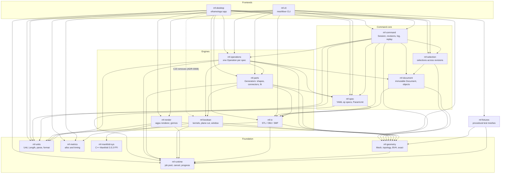
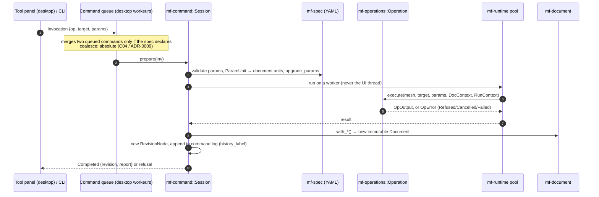
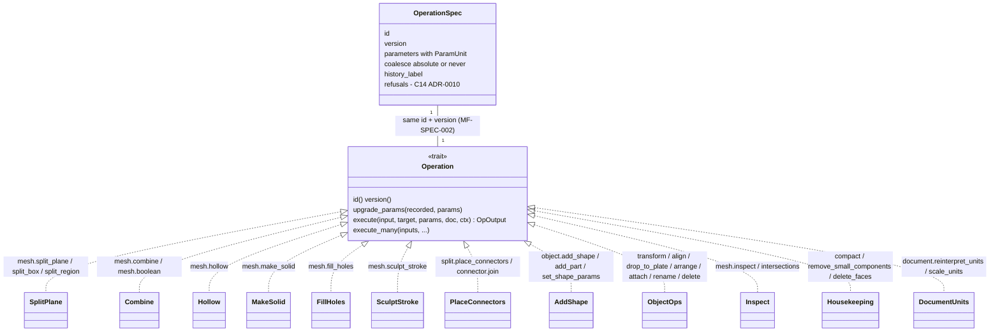
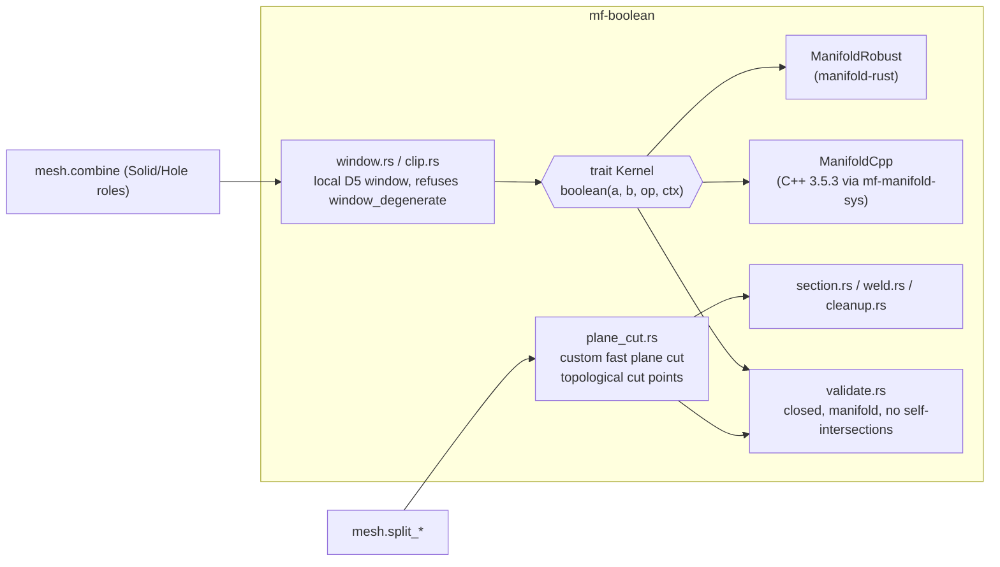
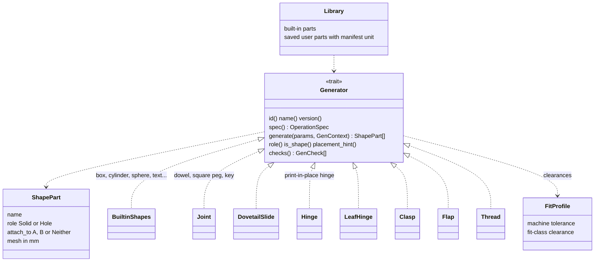
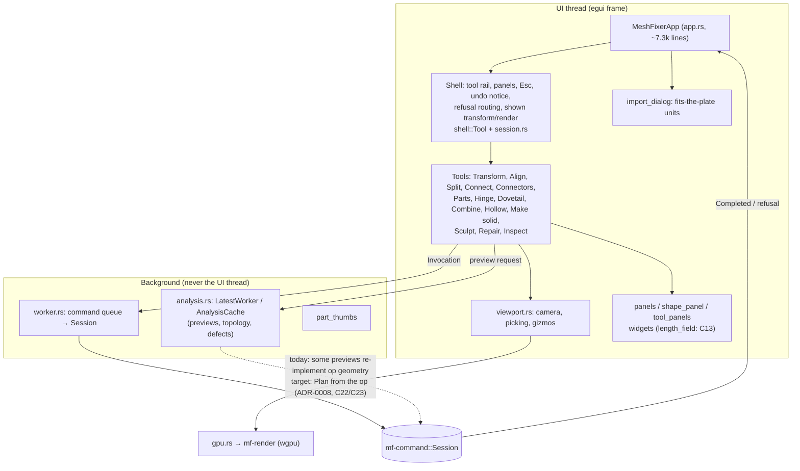
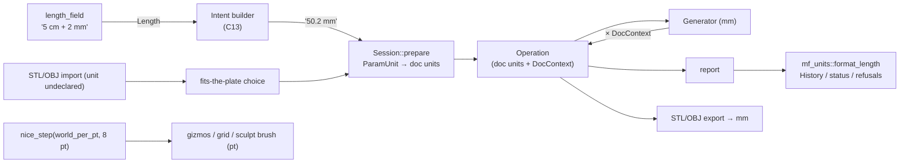

# MeshFixer architecture: as built

This describes the code as it stands on `main` at `3d4f974`, after PR #10. `docs/architecture.md` is the original vision document; this file is what exists today.

Each diagram marks where the consolidation plan is taking that area:
- solid lines and boxes are real today;
- dashed ones are planned, and the ADR named on them is the decision behind them.

ADRs live in `docs/adr/`. The plan is in `.superpowers/sdd/2026-11-10-phase1-modelling-tools/consolidation-plan.md`.

## 1. Crates and dependencies

These are the 17 workspace crates. Each arrow means "depends on". The leaf crates sit at the bottom.

**Rules the dependency graph enforces:**
- **Frontends are thin.** Desktop and CLI change a document only through `mf-command::Session` (MF-CMD-001).
- **No GUI types below the frontends.** `mf-render` knows wgpu but not egui.
- **`mf-units` and `mf-runtime` are leaves**, so any crate can use them.
- **Known violation:** `mf-desktop` depends on `mf-boolean`, because some previews re-implement op geometry. ADR-0008 removes that dependency (task C23), and then the compiler enforces the rule.

## 2. The command path: how anything changes a document

Every change, whether a click, a CLI subcommand or a replayed log, goes through the same path.

- **Units have one boundary.** Ops see document units only. Of the ops, only the ones that place mm-internal generators read `DocContext` (C07, C10, C12). C13 moves the desktop-side conversion into one typed `Intent` builder.
- **Replay is Exact.** `replay(dir)` re-runs the command log, and `upgrade_params` maps old param versions onto new ones.
- **Undo and redo** move between `RevisionNode`s. Documents are immutable values, so a revision is a pointer.

## 3. Operations: one spec, one implementation

The 30 specs are in `specs/operations/*.yaml`. The CLI builds its subcommands from them, and the desktop builds its panels and History labels from them.

## 4. Engines

### 4a. Boolean and cut (`mf-boolean`)

- **Combine uses Manifold** (ADR-0002).
- **Split uses the custom plane cut.** It does 30M triangles in 1.40 s with about 312 MB working memory. Manifold took 33 s and 17 GB and was rejected. See `docs/performance.md`.

### 4b. Generators: shapes and connectors (`mf-parts`, ADR-0005)

Generators work in mm. The op that places them scales the result once, using `DocContext` (D16, C10, C12).

### 4c. Other engines in `mf-operations`

| Module | Engine |
|---|---|
| `hollow.rs` | sparse-band SDF inner offset, plus marching tetrahedra; the opening follows the cavity's cross-section |
| `make_solid.rs` | generalized winding number / SDF, plus dual contouring |
| `fill_holes/` | triangulate → refine → fair |
| `sculpt/` | brush, falloff, a spatial index, local remesh |
| `split/` | plane/box/region split; `joints.rs` (connector placement and fit), `pegs.rs`, `dovetail.rs` |
| `blend.rs` | seam blend within a local window |

### 4d. Geometry foundation (`mf-geometry`)

`Mesh` uses stable-slot chunked storage (ADR-0001). Alongside it the crate provides:
- topology;
- a BVH;
- intersections;
- validation;
- affine transforms;
- `exact`, the only place "on plane", "same point" and "inside" are decided (ADR-0011, C20);
- hashing for revision identity.

## 5. Desktop application (`mf-desktop`)

**Where the one-offs still are, and the ADR that removes each one:**

| Today | Target | ADR / task |
|---|---|---|
| Done for Transform, Align, Combine, Make solid, Parts, Connectors and Repair (C21): each is a `ToolSession` holding its own state; the shell (`session.rs`) derives the shown transform and render, the Esc order, undo notice and refusal routing. Split, Connect, Hollow and Sculpt are thin adapters around their old app fields; the hinge swing is read by the shell. `tests/session_contract.rs` checks every tool; `tests/lint_tools.rs` keeps tool modules out of `app.rs`. | Split and Connect sessions (C23), Hollow and Sculpt (C24), hinge and dovetail generator facts (C26) | ADR-0007 / C21, C23, C24, C26 |
| Previews re-run op geometry in the desktop, sometimes on the UI thread | The op exposes `plan()`, and preview and Apply share it | ADR-0008 / C22, C23 |
| `LatestWorker`, ad-hoc threads and `pending_*` fields | Three lanes (command queue, `PreviewSlot`, pick lane); coalescing declared per spec | ADR-0009 / C04 done, C19 |
| Refusals land in the generic error bar | A `RefusalCard` in the panel of the tool that issued the command | ADR-0010 / C14, C16 |
| Per-tool ray picking and region growth | `PickService` and `SelectionKind` | ADR-0012 / C24 |
| Tolerance literals scattered through the code | `mf_geometry::exact`, plus `docs/tolerances.allow` | ADR-0011 / C20 done |

## 6. Units, scale and precision (ADR-0006)

## 7. Tests as architecture

| Tier | What | When |
|---|---|---|
| Targeted | crate and test-file runs | every change |
| `scripts/core-workflows.sh` | 59 end-to-end GUI flows, including the owner's bunny repros | before every demo and every merge |
| `scripts/check.sh` | fmt, clippy, swallow lint, epsilon lint, licences, about 1,250 tests | once per wave, on the merged branch |
| Heavy (`check.sh --full`) | 5M and 30M timing and memory, the messy corpus, idle memory | on demand only |
| Benchmarks | `scripts/bench-*.sh` → `docs/perf/history.jsonl` | on demand; recorded |

**Rule-enforcing tests**, which fail on any new violation rather than on one example:
- every spec has a `history_label`;
- every spec declares `coalesce`;
- every length param declares a unit;
- the epsilon lint;
- the swallowed-defaults lint;
- `snap_step_is_8pt_at_any_zoom`.

Still to come:
- the unit-conversion lint (C13);
- the refusal registry tests (C14);
- the session-contract harness (C21);
- the scale matrix (C29).
